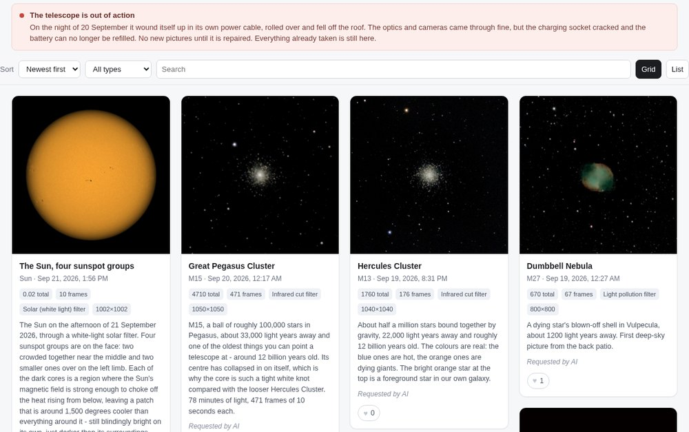
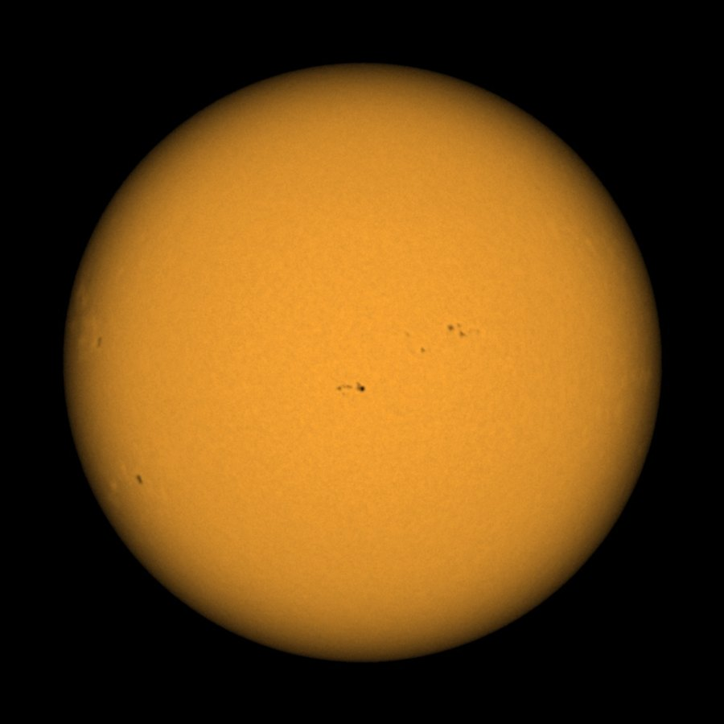
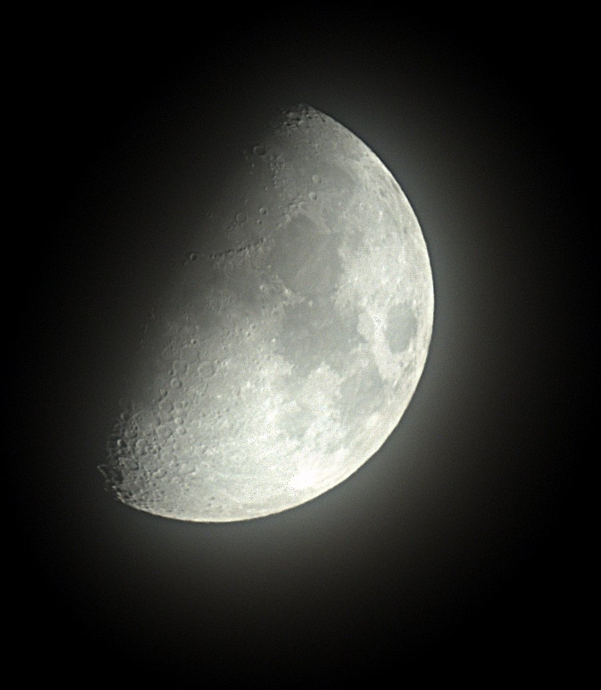
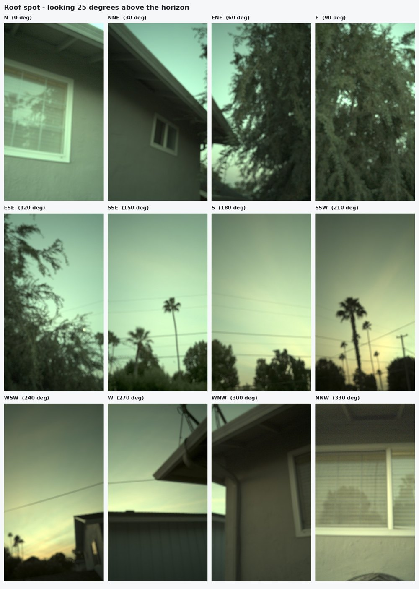

# Seestar Observatory

A ZWO Seestar S50 that runs itself all night, and a public website where anyone can ask
it to photograph something.

Point it at a garden, a roof, a balcony. After dark it wakes up on its own, works through
a list of targets, stacks each one, renders a finished picture, and publishes it. In the
morning it parks and turns itself off. Visitors to the site can browse what it has taken,
like pictures, and put in a request; the owner approves requests, and approved ones go to
the front of the queue.



Three pieces, each usable on its own:

| | |
|---|---|
| **`skills/seestar/`** | The control library and the `seestar` command line. Talks to the scope over its native JSON-RPC protocol and its ASCOM Alpaca server. Slew, focus, stack, pull frames, stack and render images, manage a gallery. Also packaged as a [Claude Code](https://claude.com/claude-code) skill, so an AI agent can drive the telescope conversationally. |
| **`runner/`** | The unattended night runner. A systemd user service that plans a night, watches the weather, drives the scope, handles clouds and dew, and stops when something is wrong. |
| **`public-site/`** | The public website: gallery, likes, a request queue, and an owner admin page. Flask + SQLite in a Docker container behind nginx. It never calls home, holds no private addresses, and has no credentials for anything on your network. |

## Documentation

- **[SETUP.md](SETUP.md)** - start here. Getting the scope on your network, installing,
  configuring, surveying your horizon, the first night, and putting the website up.
- **[OPERATING.md](OPERATING.md)** - how to actually run a night. Hard rules, pointing,
  exposure, clouds, the image pipeline, and every mistake already made so you do not have
  to repeat them. Read this before the first command.
- **[docs/seestar-device-notes.md](docs/seestar-device-notes.md)** - the device itself:
  activation, station mode, protocol notes, what the firmware exposes.
- **[public-site/SPEC.md](public-site/SPEC.md)** - what the website does, page by page.

## Quick start

```bash
git clone <this repo> seestar-observatory && cd seestar-observatory
python3 -m venv skills/seestar/.venv
skills/seestar/.venv/bin/pip install -r requirements.txt
./scripts/fetch-ephemeris.sh

mkdir -p ~/.config/seestar
cp skills/seestar/seestar.env.example ~/.config/seestar/seestar.env
$EDITOR ~/.config/seestar/seestar.env     # scope IP, your latitude and longitude

skills/seestar/seestar status
```

Everything personal lives in that one file, outside the repo. Nothing in this tree
contains an address, a coordinate or a credential.

## What it actually produces

The scope is a 50 mm f/5 refractor with a 250 mm focal length and an IMX462 sensor: a
field about 2.8 x 1.6 degrees, 10-second sub-exposures, stacked in the scope's own
firmware. It is not a research instrument. On a good night it will give you a bright
galaxy, a large nebula, a planet as a small disc, and a very good Moon and Sun (with the
supplied solar filter). Faint detail wants hours, not minutes.

| | | |
|---|---|---|
|  |  |  |
| The Sun through the solar filter, 10 frames at 1/50 s | The Moon, single session | The Veil Nebula, 78 minutes of 10-second subs |

And the horizon survey from part 4 of the setup, which is what tells the planner where it
can and cannot point:



## Before you run this

Three things will bite you, in order of how much they cost:

1. **Do not leave it plugged into a wall socket.** The scope rotates. A fixed cable wraps
   around it and pulls it over. One of these fell off a roof that way and cracked its
   charging port. Run it on battery, or put a power bank on the tripod so the cable turns
   with the scope.
2. **Survey your horizon before your first night.** Trees and rooflines will eat half your
   targets, and you will not find out until you have wasted the hours. `skysurvey.py`
   sweeps the wide camera around and builds contact sheets; the result goes in
   `runner/horizon.json`.
3. **Decide where you will not point it.** A 250 mm lens over a fence is a camera pointed
   into someone's home. Put those compass bearings in `SEESTAR_PRIVACY_AZ` and both the
   runner and the daylight check will refuse them.

## Credits and licence

MIT, see [LICENSE](LICENSE). Built on [seestarpy](https://pypi.org/project/seestarpy/)
and [skyfield](https://rhodesmill.org/skyfield/), and on the community's
reverse-engineering of the Seestar protocol. Not affiliated with ZWO.
